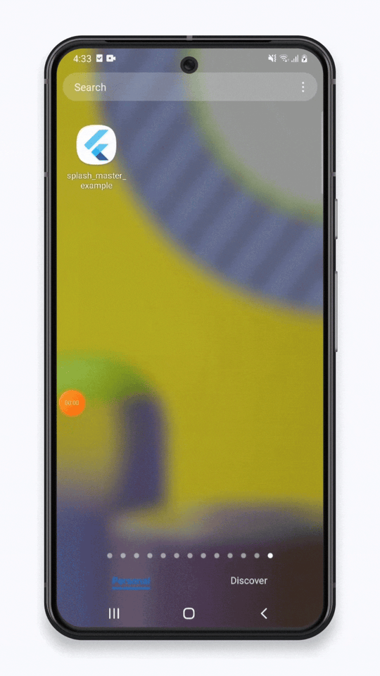
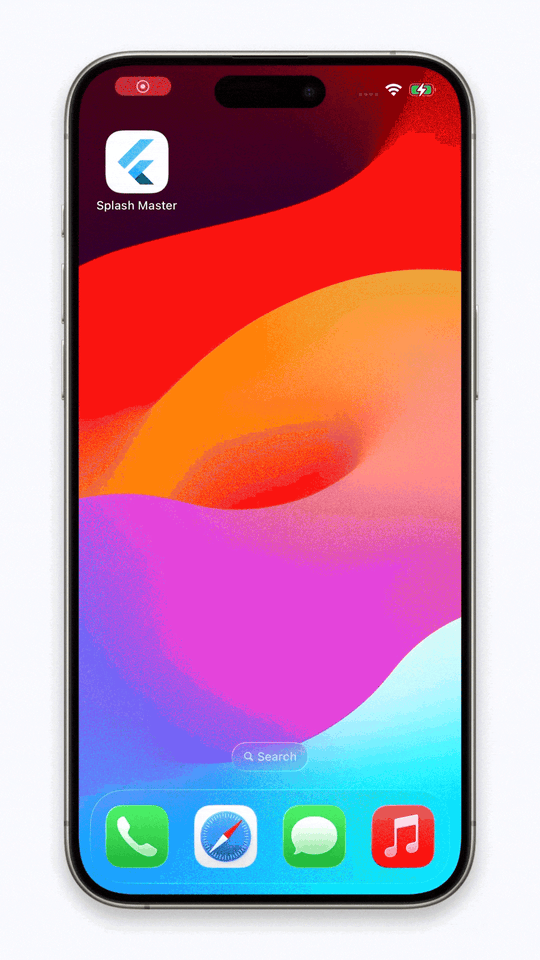

# Overview

Splash Master is a Flutter plugin designed to make adding splash screens to your app quick, effortless, and highly customizable. It handles all the native-side setup for you — generating Android and iOS splash screen assets directly from your `pubspec.yaml` — saving valuable development time and effort.

## Preview

| Android                                                                                                                                                                     | iOS                                                                                                                                                                 |
|-----------------------------------------------------------------------------------------------------------------------------------------------------------------------------|---------------------------------------------------------------------------------------------------------------------------------------------------------------------|
|  |  |

## Features

- **Native Integration**: Automatically sets up native splash screens for Android and iOS via a single CLI command.
- **Dark Mode Support**: Configure light and dark splash assets for both Android and iOS.
- **Easy Configuration**: Define all splash details in your `pubspec.yaml` — no manual native editing required.
- **Smooth Transition**: Ensures a seamless transition from the native splash to your Flutter app.
- **Highly Customizable**: Control background color, image, gravity/content mode, Android 12+ splash icon, and branding image.
- **Animation Support**: Extend with `splash_master_rive`, `splash_master_video`, or `splash_master_lottie` for animated splashes.

## Package Structure

| Package | Contents |
|---|---|
| `splash_master` | CLI tool, native splash generation (Android/iOS), shared types (`Source`, `VisibilityEnum`) |
| [`splash_master_rive`](../splash_master_rive/README.md) | `SplashMasterRive` widget, `RiveConfig`, `RiveFileSource` — Rive animation splash |
| [`splash_master_video`](../splash_master_video/README.md) | `SplashMasterVideo` widget, `VideoConfig` — video splash screen |
| [`splash_master_lottie`](../splash_master_lottie/README.md) | `SplashMasterLottie` widget, `LottieConfig` — Lottie animation splash |

All sub-packages **re-export `splash_master`**, so one import covers both the animation widget and shared types.

# Installation

## 1. Add dependency to `pubspec.yaml`

Add the core package for CLI/native splash generation:

```yaml
dependencies:
  splash_master: ^1.0.0
```

> For animated splash screens (video, Lottie, Rive), see the relevant sub-package documentation instead. Each sub-package re-exports `splash_master`, so you only need one dependency.

## 2. Install packages

```bash
flutter pub get
```

## 3. Import the package

```dart
import 'package:splash_master/splash_master.dart';
```

# Basic Usage

This section guides you through the essential steps to implement Splash Master in your Flutter app.

## 1. Configure Splash Master in `pubspec.yaml`

Add a `splash_master` section to your `pubspec.yaml` file. Here's the structure:

```yaml
splash_master:
  color: '#FFFFFF'
  image: 'assets/splash.png'
  color_dark: '#000000'
  image_dark: 'assets/splash_dark.png'
  background_image: 'assets/background.png'
  background_image_dark: 'assets/background_dark.png'
  ios_content_mode: 'center'
  ios_background_content_mode: 'scaleToFill'
  android_gravity: 'center'
  android_dark_gravity: 'center'
  android_background_image_gravity: 'fill'
  
  android_12_and_above:
    color: '#FFFFFF'
    image: 'assets/splash_12.png'
    color_dark: '#000000'
    image_dark: 'assets/splash_12_dark.png'
    branding_image: 'assets/branding.png'
    branding_image_dark: 'assets/branding_dark.png'
```

**Note:** You only need to include parameters relevant to your use case.

## Configuration Reference

All parameters, their purpose, platform support, validity, and fallback behavior:

| Parameter | Type | Platforms | Description | Fallback Behavior | Valid Values |
|-----------|------|-----------|-------------|-------------------|--------------|
| **LIGHT MODE** |
| `color` | String | Android, iOS | Background color (hex code) | **iOS:** Defaults to `#FFFFFF` when omitted. **Android:** No color resource is generated unless provided. | Hex color code, e.g., `#FFFFFF` |
| `image` | String | Android, iOS | Splash image path | **None** — no image generated | Asset path, e.g., `assets/splash.png` |
| `background_image` | String | Android, iOS | Optional background image behind splash | **None** — no background layer | Asset path |
| **DARK MODE** |
| `color_dark` | String | Android, iOS | Dark mode background color | **No dark-specific override** — light/default background behavior remains | Hex color code |
| `image_dark` | String | Android, iOS | Dark mode splash image | **No dark-specific override** — light image behavior remains | Asset path |
| `background_image_dark` | String | Android, iOS | Dark mode background image | **No dark-specific override** — light background-image behavior remains | Asset path |
| **iOS POSITIONING** |
| `ios_content_mode` | String | iOS only | How to display splash image | Defaults to `scaleToFill` | `scaleToFill`, `scaleAspectFit`, `scaleAspectFill`, `redraw`, `center`, `top`, `bottom`, `left`, `right`, `topLeft`, `topRight`, `bottomLeft`, `bottomRight` |
| `ios_background_content_mode` | String | iOS only | How to display background image | Defaults to `scaleToFill` (independent of `ios_content_mode`) | Same as `ios_content_mode` |
| **ANDROID PRE-12 POSITIONING** |
| `android_gravity` | String | Android (pre-API 31) | Splash image position | Defaults to `fill` | `center`, `clip_horizontal`, `clip_vertical`, `fill_horizontal`, `fill`, `center_vertical`, `bottom`, `fill_vertical`, `center_horizontal`, `top`, `end`, `left`, `right`, `start` |
| `android_dark_gravity` | String | Android (pre-API 31) | Dark splash image position | **Falls back to `android_gravity`** | Same as `android_gravity` |
| `android_background_image_gravity` | String | Android (pre-API 31) | Background image position | Defaults to `fill` | Same as `android_gravity` |
| **ANDROID 12+ (inside `android_12_and_above`)** |
| `color` | String | Android 12+ (API 31+) | Background color for system splash | **None** — does NOT fall back to top-level `color` | Hex color code |
| `image` | String | Android 12+ (API 31+) | Icon for system splash (replaces app icon) | **None** — uses system default app icon | Asset path (ideally 288x288dp) |
| `color_dark` | String | Android 12+ (API 31+) | Dark mode background color | **None** — no dark background applied | Hex color code |
| `image_dark` | String | Android 12+ (API 31+) | Dark mode icon | **Falls back to `android_12_and_above.image`** | Asset path |
| `branding_image` | String | Android 12+ only | Branding image at bottom (max 80dp height) | **None** — no branding shown | Asset path |
| `branding_image_dark` | String | Android 12+ only | Dark mode branding image | **Falls back to `android_12_and_above.branding_image`** | Asset path |

### Key Points

- **Only valid inside `android_12_and_above`:** `branding_image`, `branding_image_dark` (will be rejected at top level)
- **Top-level dark keys are cross-platform:** `image_dark`, `color_dark`, and `background_image_dark` apply to both Android and iOS.
- **No cross-version fallback:** Android 12+ parameters do NOT fall back to top-level parameters (independent namespaces)
- **Gravity ignored on Android 12+:** System splash API centers all content; gravity settings are not used
- **iOS dark appearance uses paired assets:** when using dark variants (`image_dark`, `background_image_dark`), also provide the corresponding light variants (`image`, `background_image`) for Any appearance.
- **Within-namespace fallback only:** Dark mode can fall back to light mode within the same version, but never across versions

## 2. Generate Native Splash Screen

Run the following command to set up the native splash screen:

```bash
dart run splash_master create
```

Alternatively, activate Splash Master globally:

```bash
dart pub global activate splash_master
splash_master create
```

## 3. Integrate Splash Master in Flutter

For a native image/color splash, **no Flutter-side code is required**. The `splash_master` package is a CLI tool — once you run `dart run splash_master create`, the native splash is fully set up and transitions automatically to your Flutter app when it starts.

> For animated splash screens (video, Lottie, Rive), see the respective sub-package documentation:
> - [`splash_master_video`](../splash_master_video/README.md)
> - [`splash_master_lottie`](../splash_master_lottie/README.md)
> - [`splash_master_rive`](../splash_master_rive/README.md)


# Advanced Usage

## Dark Mode

Add dark mode variants of your splash assets using the `_dark` key suffixes. Both Android and iOS are supported:

```yaml
splash_master:
  color: '#FFFFFF'
  image: 'assets/splash.png'
  color_dark: '#000000'
  image_dark: 'assets/splash_dark.png'
  background_image: 'assets/bg.png'
  background_image_dark: 'assets/bg_dark.png'
```

Then re-run `dart run splash_master create` to regenerate native assets.

## Android 12+ Splash

Android 12 introduced a new system splash API. Configure it using the `android_12_and_above` block:

```yaml
splash_master:
  # Pre-Android 12
  color: '#FFFFFF'
  image: 'assets/splash.png'

  # Android 12+ (independent block)
  android_12_and_above:
    color: '#FFFFFF'
    image: 'assets/splash_12.png'        # 288x288dp recommended
    color_dark: '#000000'
    image_dark: 'assets/splash_12_dark.png'
    branding_image: 'assets/branding.png'       # max 80dp height
    branding_image_dark: 'assets/branding_dark.png'
```

> **Note:** `android_12_and_above` values are independent — they do **not** fall back to top-level values.

## Shared Types

The following types are exported from `splash_master` and shared across all sub-packages:

| Type | Description |
|---|---|
| `Source` | Abstract base class for all asset sources |
| `AssetSource(path)` | Asset bundled inside the Flutter app |
| `NetworkFileSource(url)` | Asset loaded from a remote URL |
| `DeviceFileSource(path)` | Asset from a local device file path |
| `BytesSource(bytes)` | Asset provided as raw `Uint8List` bytes |
| `VisibilityEnum` | Controls how media is displayed (`useFullScreen`, `useAspectRatio`, `none`) |

# Migration Guides
This document provides guidance for migrating between different versions of the Splash Master package.

## Migrating from 0.0.3 to 1.0.0

This version standardizes dark-mode keys, enforces strict config validation, introduces clearer Android 12\+ behavior and dark mode in iOS. It also moves animation widgets out of `splash_master` into dedicated sub-packages.

### Flutter Widget API Changes

The `SplashMaster` widget and its static methods have been removed from the `splash_master` package. Animation widgets now live in dedicated sub-packages:

| Before (0.0.3)              | After (1.0.0)                                                     | Package                |
|-----------------------------|-------------------------------------------------------------------|------------------------|
| `SplashMaster.rive(...)`    | `SplashMasterRive(...)`                                           | `splash_master_rive`   |
| `SplashMaster.video(...)`   | `SplashMasterVideo(...)`                                          | `splash_master_video`  |
| `SplashMaster.lottie(...)`  | `SplashMasterLottie(...)`                                         | `splash_master_lottie` |
| `SplashMaster.initialize()` | `<Widget>.initialize()`; see [7)](#7-removed-splashmaster-lifecycle-methods) for other apps           | same as the widget     |
| `SplashMaster.resume()`     | Remove; `<Widget>.resume()` only inside a custom `onSourceLoaded` | same as the widget     |

Apps without a Flutter animation widget don't need a sub-package. If they use **only** the native image/color splash, they must delete any `SplashMaster.initialize()` and `SplashMaster.resume()` calls. If they show their own Flutter splash widget, they replace the calls with `WidgetsBinding.instance.deferFirstFrame()` and `allowFirstFrame()`. See [7) Removed SplashMaster Lifecycle Methods](#7-removed-splashmaster-lifecycle-methods).

> `RiveFileSource` is available in `splash_master_rive`. Import `package:splash_master_rive/splash_master_rive.dart` to access it.

## Breaking Changes Summary

| Area | 0.0.3 behavior | 1.0.0 behavior |
| --- | --- | --- |
| Dark-mode key names | Platform-specific `_android` suffix keys were used | Cross-platform keys are required |
| Android 12+ configuration | Android 12+ values existed as nested config but without strict nested-key enforcement | `android_12_and_above` is treated as an explicit nested block and validated independently |
| `android_dark_gravity` fallback | Could independently default to `fill` | Falls back to `android_gravity` when omitted |
| Validation strictness | Legacy/unknown keys could still exist in configs | Unsupported keys are rejected with a validation error |
| iOS content mode aliases | `aspectFit` and `aspectFill` were accepted aliases | Use `scaleAspectFit` and `scaleAspectFill` |
| `SplashMaster` widget | `SplashMaster.rive()`, `.video()` and `.lottie()` in `splash_master` | Removed. Use `SplashMasterRive`, `SplashMasterVideo` or `SplashMasterLottie` from the sub-packages |
| `SplashMaster.initialize()` / `SplashMaster.resume()` | Static methods on `SplashMaster`. The README called `initialize()` in `main` for every splash type, and `resume()` for the image splash | Removed. Animation widgets use `<Widget>.initialize()`; native image/color splash needs neither call; a custom splash widget calls `WidgetsBinding.instance.deferFirstFrame()` and `allowFirstFrame()` |

## 1) Dark Mode Key Renames

The following key names changed and old names are no longer accepted:

| Old key (master) | New key (1.0.0) |
| --- | --- |
| `image_dark_android` | `image_dark` |
| `color_dark_android` | `color_dark` |

### Before (0.0.3)

```yaml
splash_master:
  image: 'assets/splash.png'
  color: '#FFFFFF'
  image_dark_android: 'assets/splash_dark.png'
  color_dark_android: '#000000'
```

### After (1.0.0)

```yaml
splash_master:
  image: 'assets/splash.png'
  color: '#FFFFFF'
  image_dark: 'assets/splash_dark.png'
  color_dark: '#000000'
```

If you keep old keys, validation fails with an unsupported key error.

## 2) Android 12+ Configuration Rules

Android 12+ values must be provided inside `android_12_and_above`, and nested
keys are validated strictly.

In 1.0.0:

- If `android_12_and_above.color` is omitted, no Android 12+ background color is applied.
- If `android_12_and_above.image` is omitted, the system default app icon is used.
- If `android_12_and_above.color_dark` is omitted, no Android 12+ dark background color is applied.
- If `android_12_and_above.image_dark` is omitted, it falls back only to `android_12_and_above.image`.

### Recommended explicit config

```yaml
splash_master:
  # Pre-Android 12
  image: 'assets/splash_pre12.png'
  color: '#FFFFFF'
  image_dark: 'assets/splash_pre12_dark.png'
  color_dark: '#111111'

  # Android 12+ (independent)
  android_12_and_above:
    image: 'assets/splash_12.png'
    color: '#FFFFFF'
    image_dark: 'assets/splash_12_dark.png'
    color_dark: '#000000'
    branding_image: 'assets/branding.png'
    branding_image_dark: 'assets/branding_dark.png'
```

## 3) android_dark_gravity Fallback Change

Compared to 0.0.3, omitting `android_dark_gravity` no longer implies an
independent default behavior. In 1.0.0, it falls back to `android_gravity`.

If you relied on dark mode using `fill` while light mode used a different
gravity, set `android_dark_gravity` explicitly.

```yaml
splash_master:
  android_gravity: 'center'
  android_dark_gravity: 'fill'
```

## 4) iOS Content Mode Alias Update

In 0.0.3, `aspectFit` and `aspectFill` were accepted aliases.
In 1.0.0, use `scaleAspectFit` and `scaleAspectFill`.

```yaml
splash_master:
  ios_content_mode: 'scaleAspectFit'
  ios_background_content_mode: 'scaleAspectFill'
```

## 5) Newly Added Dark-Mode Keys in 1.0.0

The following are new additions in 1.0.0 (not renames from 0.0.3):

- `background_image_dark` (top-level dark background image)
- `android_12_and_above.image_dark`
- `android_12_and_above.color_dark`
- `android_12_and_above.branding_image_dark`

Also, `android_background_image_gravity` now applies to dark background images
when `background_image_dark` is used on Android.

## 6) Validation is Stricter

1.0.0 validates config keys strictly. Remove legacy keys and keep only supported
keys, including supported nested keys under `android_12_and_above`.

## 7) Removed SplashMaster Lifecycle Methods

`SplashMaster.initialize()` and `SplashMaster.resume()` were removed together with the `SplashMaster` widget. Code that still calls them fails to compile with `Undefined name 'SplashMaster'`.

Both methods were thin wrappers: `initialize()` called `WidgetsBinding.instance.deferFirstFrame()` to keep the native splash on screen, and `resume()` called `WidgetsBinding.instance.allowFirstFrame()` to release it.

### Native image/color splash only

The 0.0.3 README told image-splash apps to call both methods in `main`. Delete both calls. The native splash stays on screen until Flutter draws its first frame, so anything you `await` before `runApp` still runs while it is visible.

#### Before (0.0.3)

```dart
import 'package:flutter/material.dart';
import 'package:splash_master/splash_master.dart';

void main() {
  WidgetsFlutterBinding.ensureInitialized();
  SplashMaster.initialize();
  // Setup your config before the resume.
  SplashMaster.resume();
  runApp(const MyApp());
}
```

#### After (1.0.0)

```dart
import 'package:flutter/material.dart';

void main() {
  WidgetsFlutterBinding.ensureInitialized();
  // Setup your config before runApp.
  runApp(const MyApp());
}
```

### Animation widgets (Rive, Video, Lottie)

Replace `SplashMaster.initialize()` with the `initialize()` method of the widget you use: `SplashMasterRive.initialize()`, `SplashMasterVideo.initialize()` or `SplashMasterLottie.initialize()`.

Call only `initialize()` in `main`. The widget calls its own `resume()` once the source has loaded. A custom `onSourceLoaded` callback replaces that call, so if you pass one, call `<Widget>.resume()` inside it. Don't call `resume()` in `main`: that releases the first frame before the animation is ready.

`SplashMasterRive` and `SplashMasterVideo` also call `resume()` when the source fails to load. `SplashMasterLottie` doesn't: if the animation fails to load, the app stays on the native splash. Prefer an `AssetSource` that ships with the app, and test network sources offline.

#### Before (0.0.3)

```dart
import 'package:flutter/material.dart';
import 'package:splash_master/splash_master.dart';

void main() {
  WidgetsFlutterBinding.ensureInitialized();
  SplashMaster.initialize();
  runApp(
    MaterialApp(
      home: SplashMaster.rive(
        source: AssetSource('assets/animation.riv'),
        nextScreen: const MyApp(),
      ),
    ),
  );
}
```

#### After (1.0.0)

```dart
import 'package:flutter/material.dart';
import 'package:splash_master_rive/splash_master_rive.dart';

void main() {
  WidgetsFlutterBinding.ensureInitialized();
  SplashMasterRive.initialize();
  runApp(
    MaterialApp(
      home: SplashMasterRive(
        source: AssetSource('assets/animation.riv'),
        nextScreen: const MyApp(),
      ),
    ),
  );
}
```

### Custom splash widget

The 0.0.3 README also showed `SplashMaster.initialize()` with your own widget as `home`, leaving it to call `SplashMaster.resume()` once it was ready. 1.0.0 has no replacement in `splash_master`, and you don't need a sub-package: call the two Flutter methods they wrapped.

Call `allowFirstFrame()` exactly once for each `deferFirstFrame()`. Until it runs, the native splash stays on screen, so call it when loading fails as well.

#### Before (0.0.3)

```dart
import 'package:flutter/material.dart';
import 'package:splash_master/splash_master.dart';

void main() {
  WidgetsFlutterBinding.ensureInitialized();
  SplashMaster.initialize();
  runApp(const MaterialApp(home: MySplash()));
}

// Inside MySplash, once it is ready to show:
// SplashMaster.resume();
```

#### After (1.0.0)

```dart
import 'package:flutter/material.dart';

void main() {
  WidgetsFlutterBinding.ensureInitialized();
  // Replaces SplashMaster.initialize().
  WidgetsBinding.instance.deferFirstFrame();
  runApp(const MaterialApp(home: MySplash()));
}

class MySplash extends StatefulWidget {
  const MySplash({super.key});

  @override
  State<MySplash> createState() => _MySplashState();
}

class _MySplashState extends State<MySplash> {
  @override
  void initState() {
    super.initState();
    _load();
  }

  Future<void> _load() async {
    try {
      // Load what your splash needs.
    } finally {
      // Replaces SplashMaster.resume().
      WidgetsBinding.instance.allowFirstFrame();
    }
  }

  @override
  Widget build(BuildContext context) => const ColoredBox(color: Colors.white);
}
```

#### For a complete list of changes and new features in each version, please refer to [CHANGELOG.md](https://github.com/SimformSolutionsPvtLtd/splash_master/blob/master/splash_master/CHANGELOG.md) on Github.

# AI Agent Skills

This package ships two [agent skills](https://dart.dev/tools/pub/package-skills) for coding agents (Claude Code, Cursor, Copilot, Codex, …): `splash-master-native-splash` (configure and generate the native splash) and `splash-master-migration` (migrate from 0.0.x to 1.x). Install them from your app's root (needs Dart 3.10 or later):

```bash
dart run skills@ get
```

Run it again after upgrading `splash_master` to update the skills.

Upgrading from 0.0.x? Upgrade first (`flutter pub upgrade --major-versions splash_master`), run the command above, then ask your agent to migrate the project.

# Contributors

The following individuals have played a key role in developing and maintaining the Splash Master package.

## Main Contributors

|  |  |  | 
|:------------------------------------------------------------------:|:------------------------------------------------------------------:|:------------------------------------------------------------------:|
| [Ujas Majithiya](https://github.com/Ujas-Majithiya)                | [Apurva Kanthraviya](https://github.com/apurva780)                 | [Dhaval Kansara](https://github.com/DhavalRKansara)                |

## Contribute
We welcome contributions to Splash Master! To get started:

1. Fork the repository to your GitHub account.
2. Create a new branch for your changes (`git checkout -b feature/your-feature-name`).
3. Make your improvements or bug fixes.
4. Commit your changes with a clear message (`git commit -m 'Describe your change'`).
5. Push your branch to your fork (`git push origin feature/your-feature-name`).
6. Submit a Pull Request for review.

## Contribution Tips

- Stick to the project's coding standards and guidelines.
- Write meaningful commit messages.
- Include tests for any new features or fixes.
- Update documentation if your changes affect usage.
- Ensure all tests pass before submitting your pull request.
- Double-check that your changes do not break existing functionality.

For more details, visit the [Splash Master GitHub repository](https://github.com/SimformSolutionsPvtLtd/splash_master).
# License

```
MIT License

Copyright (c) 2024 Simform Solutions

Permission is hereby granted, free of charge, to any person obtaining a copy
of this software and associated documentation files (the "Software"), to deal
in the Software without restriction, including without limitation the rights
to use, copy, modify, merge, publish, distribute, sublicense, and/or sell
copies of the Software, and to permit persons to whom the Software is
furnished to do so, subject to the following conditions:

The above copyright notice and this permission notice shall be included in all
copies or substantial portions of the Software.

THE SOFTWARE IS PROVIDED "AS IS", WITHOUT WARRANTY OF ANY KIND, EXPRESS OR
IMPLIED, INCLUDING BUT NOT LIMITED TO THE WARRANTIES OF MERCHANTABILITY,
FITNESS FOR A PARTICULAR PURPOSE AND NONINFRINGEMENT. IN NO EVENT SHALL THE
AUTHORS OR COPYRIGHT HOLDERS BE LIABLE FOR ANY CLAIM, DAMAGES OR OTHER
LIABILITY, WHETHER IN AN ACTION OF CONTRACT, TORT OR OTHERWISE, ARISING FROM,
OUT OF OR IN CONNECTION WITH THE SOFTWARE OR THE USE OR OTHER DEALINGS IN THE
SOFTWARE.
```
